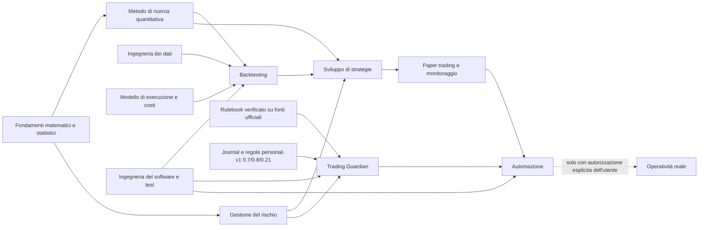

# 04 · Dipendenze tra le aree

Audit AUDIT-ARCH-20261111. Freccia A → B: "B non si può fare bene senza A".

## 1. Percorso critico per la ricerca sistematica
**Fondamenti → metodo di ricerca → dati + modello di esecuzione → backtest validato → strategie → paper → automazione.**

| Passo | Prerequisito bloccante | Stato |
|---|---|---|
| Metodo di ricerca (Modulo 8.1–8.3) | Inferenza e test multipli (10.1) | 🟡 base sufficiente per iniziare |
| Dati | Accesso a dati reali e licenze | ❌ **bloccato** (rete e dati dell'utente) |
| Modello di esecuzione | Regole di riempimento, costi realistici, dati intraday per gap e slippage | ❌ |
| Backtest | Dati + modello di esecuzione + test contro il look-ahead | ❌ |
| Strategie | Backtest validato + registro delle ipotesi | ❌ (STR-001/002 sono solo ipotesi) |
| Paper trading | Strategie validate + monitoraggio + Guardian in modalità consultiva | ❌ |
| Automazione | Paper con risultati coerenti + autorizzazione | ❌ |

## 2. Percorso del Trading Guardian (in parte indipendente)
**Regole personali (v1) + rulebook verificato + motore di rischio verificato → Guardian consultivo → Guardian che fa rispettare le regole in paper → (solo con autorizzazione) sul conto reale.**

Il Guardian in modalità consultiva **non richiede** backtest né strategie: può nascere prima dello Strategy Discovery Lab e proteggere il trading discrezionale già oggi.

| Passo | Prerequisito bloccante | Stato |
|---|---|---|
| Definizione condivisa di "Trading Guardian" | Decisione dell'utente; testi fondativi (D-09) | ❌ |
| Rulebook | Regole FTMO o del broker verificate su fonti ufficiali, con data | ❌ |
| Motore dello stato di rischio | Motore V2 corretto (C-01…C-04) + calcolo esatto canonico | 🟡 |
| Fonte dei dati del conto | Inserimento manuale o export del broker | ❌ |

## 3. Dipendenze che possono essere sviluppate in parallelo senza conflitti
| Filone | Claude | Gemini | Punto d'incontro |
|---|---|---|---|
| Fondamenti e metodo | Traccia 10.1–10.2, Modulo 8.1–8.3 (lezioni) | Revisione indipendente delle lezioni | Rapporti di revisione |
| Dati | Specifiche, controlli di qualità, lezioni sui bias | Acquisizione e pipeline (ambiente con accesso ai dati) | Formato dati + metadati + hash |
| Backtest | Casi di prova con soluzione esatta, test contro il look-ahead, revisione | Motore e modello di esecuzione | Suite di test comune |
| Rischio e Guardian | Specifica funzionale, calcolo esatto canonico, test | Rulebook, motore V3, interfaccia | Rulebook versionato + test per regola |

## 4. Rischi di dipendenza
| Rischio | Effetto | Mitigazione |
|---|---|---|
| Sviluppare il backtest prima dei dati e del modello di esecuzione | Risultati non trasferibili; overfitting | Prima le specifiche e i casi di prova con soluzione esatta |
| Sviluppare il Guardian su regole non verificate | Protezione illusoria | Ogni regola con fonte ufficiale, data e test |
| Due definizioni di Guardian (Claude e Gemini) | Lavoro duplicato o incompatibile | Specifica unica approvata dall'utente prima del codice |
| Discovery Lab senza registro delle ipotesi | Molte prove, una "scoperta" casuale | Contatore delle prove obbligatorio (documento 05) |
