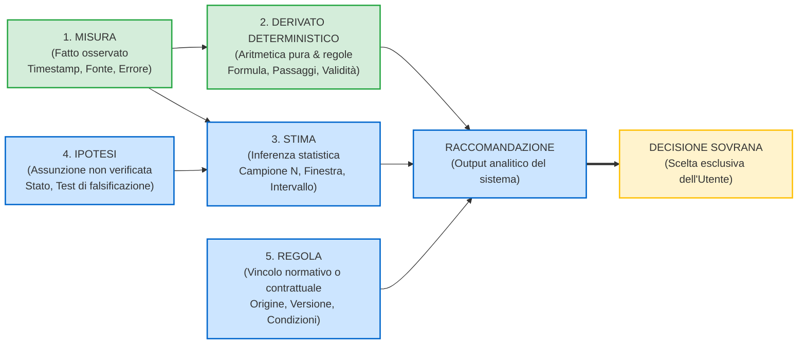
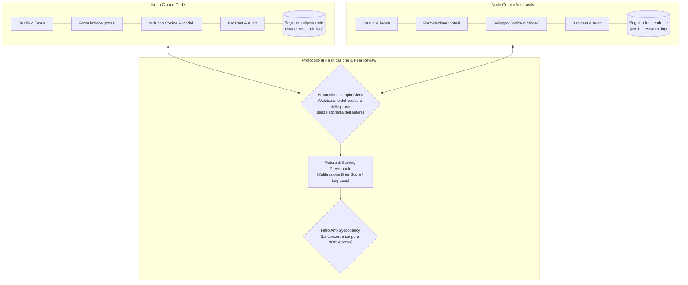
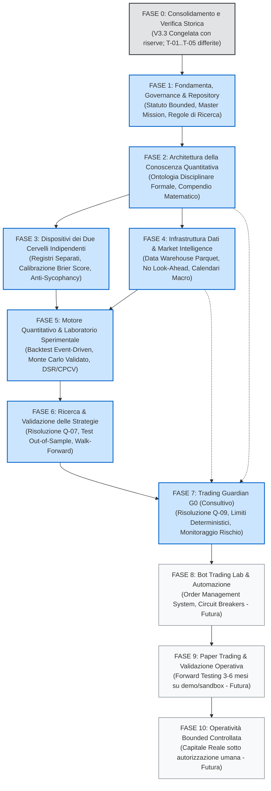

# ARCHITETTURA DEL TRADING BRAIN E ROADMAP PLURIENNALE (REVISED V2)
## Quadro di Ricerca Quantitativa, Governance Epistemologica e Pianificazione Sistemica

**Versione:** 2.0 (Revisione Integrativa e Scientifica)  
**Data:** 12 Novembre 2026  
**Autore:** Gemini Antigravity (Quantitative Research Lab)  
**Destinatario:** Gioele Melis  
**Stato Operativo:** Analisi, Governance e Pianificazione Strategica (Bounded Autonomy). Nessuna implementazione di codice, nessun commit Git, nessuna migrazione, nessuna alterazione delle versioni congelate (V2, V3, V3.1, V3.2, V3.3).

---

## 1. VISIONE STRATEGICA DEFINITIVA PROPOSTA

La visione fondativa del **Trading Brain** è definita come:

> **Un ecosistema di ricerca quantitativa disciplinato, ad autonomia bounded, dotato di due cervelli quantitativi indipendenti e simmetrici, finalizzato alla comprensione dei mercati e al supporto metodologico delle decisioni umane.**

L'obiettivo fondamentale non è creare un bot di trading o un sistema algoritmico a "scatola nera" che operi sui mercati al posto dell'uomo. È la costruzione pluriennale di un **patrimonio scientifico e computazionale condiviso**, fondato sulla falsificabilità popperiana, nel quale:
1. **L'autonomia è rigidamente circoscritta (Bounded):** Le AI dispongono di piena autonomia esplorativa, analitica e critica (studio della letteratura, formulazione di ipotesi, modellistica matematica, simulazione Monte Carlo, audit dei dati, backtesting e stress testing). Qualsiasi decisione che modifichi l'architettura di base, promuova una teoria nel patrimonio validato, allochi capitale o generi ordini su conti reali appartiene **in via esclusiva e sovrana all'utente umano (Gioele Melis)**.
2. **Indipendenza dai singoli modelli:** L'architettura software, le banche dati, le ontologie concettuali e i log di tracciabilità sono completamente disaccoppiati dagli specifici Large Language Models (LLM). L'eventuale sostituzione, aggiornamento o rimozione di Claude o Gemini non deve in alcun modo corrompere o disperdere la continuità della memoria scientifica.
3. **Assenza di finalità esecutiva immediata:** Il sistema è progettato per operare primariamente come un centro di ricerca e come uno strumento di supervisione del rischio; l'operatività finanziaria a mercato reale costituisce solo l'ultimo anello di una catena di validazione pluriennale.

---

## 2. PRINCIPI E GOVERNANCE SCIENTIFICA

### 2.1 L'Onere della Prova (Burden of Proof)
In tutto l'ecosistema vige la regola epistemologica inderogabile:
$$\text{Forza dell'evidenza richiesta} \propto \text{Forza, prescrittività o rischio dell'affermazione}$$
Nessun tono assertivo o formalismo matematico può supplire all'assenza di dati empirici. Se un'affermazione non dispone di dati sufficienti o di una dimostrazione riproducibile, deve essere etichettata esplicitamente come `IPOTESI DA VERIFICARE` o `NON STIMABILE`. L'assenza di evidenza non deve mai essere trattata come prova di assenza di rischio o come evidenza positiva.

### 2.2 Gerarchia Rigorosa delle Evidenze
Nell'acquisizione della conoscenza e nella validazione dei modelli, la priorità delle fonti è così ordinata:
1. **Meta-analisi e revisioni sistematiche peer-reviewed** (es. Cochrane-style review in econometria e finanza).
2. **Studi empirici replicati su serie storiche multi-decennali** al netto di costi di transazione, slippage e survivorship bias.
3. **Teoremi matematici e derivazioni analitiche in forma chiusa**, con verifica esplicita dei domini di validità e delle assunzioni sottostanti.
4. **Documentazione tecnica ufficiale di standard, borse e autorità di vigilanza** (es. CME Group, SEC, ESMA).
5. **Simulazioni Monte Carlo e modelli stilizzati numerici**, rigorosamente classificati come `[SIMULATO]` e mai confusi con fatti empirici.
6. **Euristiche di trading e letteratura non peer-reviewed**, considerate esclusivamente come bacino di ipotesi grezze da falsificare a freddo.

### 2.3 Classificazione Obbligatoria delle Informazioni
Ogni elemento documentale o computazionale dell'ecosistema deve dichiarare la propria natura:
- `EVIDENZA CONSOLIDATA`: Corroborata da prove robuste e replicabili nel dominio applicabile.
- `EVIDENZA EMPIRICA LIMITATA`: Supportata da studi, ma con limiti noti di campione o generalizzabilità.
- `EVIDENZA CONTRASTANTE`: Presenza di risultati discordanti nella letteratura scientifica.
- `PROPOSTA TECNICA`: Scelta ingegneristica o architetturale motivata, soggetta ad approvazione.
- `IPOTESI DA VERIFICARE`: Congettura formalizzata in attesa di test statistico.
- `DECISIONE ARCHITETTURALE`: Scelta sovrana del proprietario del progetto.
- `NON VERIFICATO`: Asserzione priva di evidenza fisica accessibile nel sistema.

---

## 3. MODELLO EPISTEMOLOGICO TRASVERSALE DEI 5 TIPI

Il modello epistemologico non è un modulo software periferico, ma il sistema operativo concettuale dell'intero Trading Brain. L'informazione fluisce in una sola direzione: **dalle Misure alle Decisioni, mai viceversa**.



### 3.1 I Cinque Tipi Fondamentali di Grandezza
1. **MISURA:** Fatto empirico oggettivamente osservato.
   - *Attributi obbligatori:* Sorgente primaria, timestamp UTC, unità di misura, precisione/risoluzione dello strumento, flag di qualità del dato (es. tick bid/ask reale con profondità).
2. **DERIVATO DETERMINISTICO:** Quantità ottenuta tramite passaggi algebrici o logici esatti a partire da Misure, senza alcun modello probabilistico intermedio.
   - *Attributi obbligatori:* Formula matematica, input utilizzati, passaggi esatti, condizioni di validità (es. perdita massima allo stop: $\text{Size} \times |\text{Entry} - \text{Stop}| + \text{Commissioni}$).
3. **STIMA:** Risultato di un'inferenza statistica su un campione storico o simulato.
   - *Attributi obbligatori:* Dimensione campionaria $N$, finestra temporale, metodo inferenziale, intervallo di incertezza (intervallo di confidenza o credibilità con livello esplicito), assunzioni distribuzionali, limiti di applicabilità.
4. **IPOTESI:** Assunzione strutturale, congettura economica o scelta parametrica non verificata.
   - *Attributi obbligatori:* Descrizione logica, stato (aperta, corroborata, falsificata), razionale economico, protocollo di falsificazione sperimentale, sensibilità dei risultati alla variazione del parametro.
5. **REGOLA:** Norma procedurale o vincolo contrattuale, non un'asserzione di verità empirica.
   - *Attributi obbligatori:* Origine (es. Regolamento FTMO vs Policy personale dell'utente), data di acquisizione, versione, perimetro di applicabilità.

### 3.2 Principio di Propagazione dell'Incertezza Epistemica
In qualsiasi combinazione di grandezze, **il tipo epistemico del risultato finale è determinato dal tipo più debole tra tutti gli input impiegati**:
$$\text{Status}(\text{Output}) = \min_{i} \left( \text{Status}(\text{Input}_i) \right)$$
*Gerarchia di robustezza:* $\text{Misura} > \text{Derivato Deterministico} > \text{Stima} > \text{Ipotesi}$.  
*Esempio:* Se una grandezza deterministica (capitale disponibile sul conto) viene moltiplicata per una stima (Expected Win Rate) e filtrata da un'ipotesi (distribuzione dei rendimenti normale priva di salti), il valore risultante ha lo status epistemico di **IPOTESI CONDIZIONATA**, e in nessun caso può essere presentato come un fatto o una stima oggettiva.

### 3.3 Regola di Precedenza: Limiti Deterministici PRIMA, Probabilità DOPO
Nella gestione del rischio e nella valutazione operativa:
1. Devono essere calcolati e mostrati in prima istanza i **limiti deterministici assoluti**:
   - Perdita massima a mercato allo Stop Loss.
   - Margine monetario residuo rispetto all'Hard Drawdown contrattuale.
   - Numero esatto di Stop Loss consecutivi tollerabili prima della violazione delle regole del conto.
2. Solo successivamente possono essere presentate le **stime probabilistiche** (es. probabilità di superamento drawdown via simulazione Monte Carlo).
3. **Regola aurea:** *Una stima probabilistica favorevole non può in nessun caso autorizzare la violazione o l'ampliamento di un limite deterministico. Una stima può solo restringere un limite prudenziale, mai allargarlo.*
4. **Comportamento su dati insufficienti:** Se i presupposti matematici o la numerosità campionaria non consentono una stima rigorosa, il sistema ha l'obbligo di emettere lo stato **`NON STIMABILE`**, astenendosi dal riempire il campo con interpolazioni non verificate.

---

## 4. ARCHITETTURA DEI DUE CERVELLI QUANTITATIVI INDIPENDENTI E SIMMETRICI

Si corregge formalmente la precedente impostazione asimmetrica: **Claude Code e Gemini Antigravity sono nodi di ricerca paritetici, speculari e reciprocamente autonomi**. Nessuno dei due è vincolato al ruolo esclusivo di "sviluppatore" o "controllore".



### 4.1 Preservazione dell'Indipendenza e Prevenzione della Falsa Concordanza
1. **Registri di Ricerca Fisicamente Separati:**
   - Gemini opera su `brain/ricerca/gemini/` e Claude su `brain/ricerca/claude/`.
   - Ciascun registro conserva la cronologia immutabile di: ipotesi formulate, script di calcolo, codici di backtest, esiti di simulazione ed errori metodologici riconosciuti.
2. **Pre-Registrazione Obbligatoria delle Ipotesi:**
   - Nessun test out-of-sample è valido se l'ipotesi e i parametri non sono stati archiviati con hash SHA-256 nel rispettivo registro **prima** dell'accesso ai dati di verifica, eliminando il *hindsight bias*.
3. **Calibrazione delle Previsioni Probabilistiche (Brier Score):**
   - Quando un modello formula una stima probabilistica $p \in [0, 1]$ su un evento discreto $o \in \{0, 1\}$ (es. persistenza di regime, probabilità di vincita di un setup), la performance predittiva nel tempo viene misurata oggettivamente tramite Brier Score (Brier 1950):
     $$\text{BS} = \frac{1}{N} \sum_{t=1}^N (p_t - o_t)^2$$
   - Il modello che esibisce under-confidence o over-confidence viene ricalibrato matematicamente.
4. **Filtro Anti-Sycophancy (Rifiuto del Conformismo LLM):**
   - I modelli LLM presentano una tendenza documentata ad allinearsi acriticamente ai prompt o ai risultati di altri agenti (Sharma et al. 2023). Pertanto, la concordanza tra Claude e Gemini su una conclusione teorica **ha valore probatorio nullo** sul mercato. Un'affermazione viene promossa solo se supportata da: (a) codice riproducibile, (b) test unitari deterministici verdi, (c) dati empirici privi di contaminazione.

---

## 5. PATRIMONIO SCIENTIFICO CONDIVISO VS REGISTRI INDIPENDENTI

L'ecosistema distingue nettamente tra lo spazio di lavoro esplorativo dei modelli e il nucleo di conoscenza validata del Trading Brain.

```
STRUTTURA DELLA CONOSCENZA NEL TRADING BRAIN
├── 1. REGISTRI DI RICERCA INDIPENDENTI (Spazio Libero Bounded)
│   ├── brain/ricerca/gemini/ (Ipotesi, script, bozze, log errori di Gemini)
│   └── brain/ricerca/claude/ (Ipotesi, script, bozze, log errori di Claude)
│
├── 2. SPAZIO DI PEER-REVIEW AVVERSARIALE (Spazio di Contestazione)
│   └── brain/peer_review/ (Confronti a doppio cieco, falsificazioni, divergenze aperte)
│
└── 3. PATRIMONIO SCIENTIFICO VALIDATO (Single Source of Truth - Core Immutabile)
    ├── Master Mission (§§0–25) [Attualmente non presente - in attesa di conferimento]
    ├── Compendio Disciplinare Validato (Dimostrazioni, formule matematiche verificate)
    ├── Registro Ufficiale Strategie (Solo strategie con OOS e WFA formalmente superati)
    └── Rulebook Normativo Certificato (Regole esterne con fonti e date accertate)
```

### Criteri Rigorosi di Promozione nel Core Condiviso
Un elemento sviluppato da Claude o da Gemini può transitare dai registri indipendenti al Patrimonio Scientifico Condiviso solo in presenza di tutte le seguenti condizioni concorrenti:
1. **Replicabilità indipendente:** Lo script o il modello deve essere eseguito dalla controparte e produrre risultati identici (o entro le tolleranze di macchina dichiarate).
2. **Audit avversariale completato:** Assenza di obiezioni metodologiche o lacune di test irrisolte.
3. **Classificazione epistemologica integra:** Presenza di tutti i metadati richiesti (assunzioni, limiti, dati utilizzati).
4. **Approvazione esplicita dell'Utente:** L'utente umano autorizza formalmente la promozione nel Core.

---

## 6. ARCHITETTURA DATI E INFRASTRUTTURA DI MERCATO

### 6.1 Data Lineage e Pulizia dei Dati
L'infrastruttura dati deve garantire che nessun dato inquinato entri nei motori di ricerca.
- **Storage locale ad alte prestazioni:** Formato tabellare immutabile a colonne (Apache Parquet / Arrow), con partizionamento per asset e timeframe.
- **Prevenzione Look-Ahead Bias:** Le serie storiche devono marcare in modo distinto il timestamp di apertura candela e il timestamp di chiusura candela. Qualsiasi calcolo eseguito al tempo $t$ può accedere unicamente a informazioni completate a $t-1$ o all'open di $t$.
- **Aggiustamento dei Contratti Futures:** Tracciamento esplicito dei metodi di roll (Panama canal, back-adjustment proporzionale, non-adjusted) con conservazione dei prezzi non corretti per l'esatta esecuzione operativa.
- **Calendari Macroeconomici:** Ingestione strutturata degli eventi macro (CPI, NFP, decisioni tassi centrali) con orari di rilascio precisi al secondo, valore precedente, consenso e valore effettivo.

### 6.2 Posizionamento e Trade-Off di TradingView
TradingView non è il motore di calcolo dell'ecosistema, ma uno strumento perimetrale specializzato.

| Aspetto Architetturale | TradingView / Pine Script | Motore Quantitativo Locale (Python/C++/Rust) | Scelta Progettuale |
| :--- | :--- | :--- | :--- |
| **Visualizzazione Grafica & UX** | Eccellente, fluida, multi-device, interattiva. | Complessa da realizzare e manutenere su desktop/web. | **TradingView per visualizzazione e telemetria operativa.** |
| **Calcolo Matematico & Statistico** | Limitato dall'ambiente sandbox single-thread di Pine Script. | Illimitato (algebra lineare, simulazioni Monte Carlo vettorializzate, machine learning). | **Motore Locale per tutta la ricerca, calcolo ed inferenza.** |
| **Storage & Integrità dei Dati** | Serie storiche limitate per barre intraday profonde; dati opachi. | Archiviazione tick/M1 locale verificata per hash, immutabile. | **Motore Locale come unica fonte di verità dei dati storici.** |
| **Generazione Alert e Segnali** | Webhook nativi a bassissima latenza verso infrastrutture server. | Richiede connessioni socket persistenti verso broker terzi. | **TradingView come possibile interfaccia di alert di contesto.** |
| **Costi e Vincoli di Integrazione** | Piani in abbonamento; rischio di modifiche alle API proprietarie. | Zero costi di licenza; totale sovranità sul codice sorgente. | **Isolamento: nessun lock-in sui formati proprietari Pine.** |

---

## 7. ARCHITETTURA QUANTITATIVA E LABORATORIO SPERIMENTALE

### 7.1 Motore di Backtest Strictly Event-Driven
Per eliminare alla radice il look-ahead bias e l'over-fitting esecutivo, il motore sperimentale deve implementare un'architettura rigorosamente a eventi:
$$\text{Segnale generato al Close}(t) \implies \text{Ordine inviato} \implies \text{Esecuzione all'Open}(t+1) + \text{Slippage}(\Delta t) + \text{Commissioni}$$
- **Divieto del "Same-Bar Fill":** È vietato assumere che un ordine stop o limit venga eseguito all'interno della stessa barra che ha generato il segnale, a meno di disporre di dati tick reali con book ad alta frequenza.
- **Modellazione dei Gap:** Se il prezzo di apertura di $t+1$ supera il livello dello Stop Loss, l'ordine stop viene eseguito al prezzo di apertura reale (gap negativo), mai al prezzo dello stop teorico.

### 7.2 Strumenti di Protezione contro il Data Snooping e l'Overfitting
1. **Deflated Sharpe Ratio (DSR):**
   - Calcolo obbligatorio del DSR (Bailey & López de Prado 2014) per correggere la misura di rendimento ponderata per il rischio in funzione del numero di prove indipendenti ($N$), della varianza delle stime e dell'asimmetria/curtosi dei rendimenti:
     $$\text{DSR} = \Phi \left( \frac{(\widehat{\text{SR}} - \text{SR}^*) \sqrt{T-1}}{\sqrt{1 - \widehat{\gamma}_3 \widehat{\text{SR}} + \frac{\widehat{\gamma}_4 - 1}{4} \widehat{\text{SR}}^2}} \right)$$
   - dove $\text{SR}^*$ è il valore atteso del massimo Sharpe Ratio ottenuto per puro caso sotto l'ipotesi nulla.
2. **Combinatorial Purged Cross-Validation (CPCV):**
   - Suddivisione delle serie storiche in blocchi combinatori con purging (eliminazione dei dati contigui per rimuovere l'autocorrelazione) ed embargo (rimozione dei trade sovrapposti post-evento), garantendo che i test out-of-sample riflettano molteplici cammini storici alternativi.

### 7.3 Limiti Epistemologici dei Modelli Matematici del Simulatore V3.x
- **Campionatore Browniano MAE:** Il campionamento del MAE via moto browniano con deriva implementato in V3.3 è algebricamente esatto rispetto alle equazioni differenziali del moto browniano unidimensionale standard (Borodin & Salminen 2002). Tuttavia, **esso non dimostra che i prezzi reali seguano un moto browniano continuo**. Nei mercati reali esistono salti discreti di liquidità (Lévy jumps, Merton 1976) e clustering di volatilità (Mandelbrot 1963) che possono generare escursioni avverse superiori a quelle previste dal modello teorico.
- **Distribuzione di Lomax per lo Slippage:** Modella efficacemente le code pesanti ($E[S] = 0.060169R$), ma rimane una distribuzione parametrica stilizzata. Lo slippage reale dipende dalla microstruttura dell'order book (Bouchaud, Farmer & Lillo 2009) e dalla dimensione dell'ordine rispetto alla profondità di mercato.

---

## 8. TRADING GUARDIAN G0: CONFIGURAZIONE CONSULTIVA

In conformità tassativa con il mandato dell'utente, **il Trading Guardian è configurato e rimarrà al livello G0 — CONSULTIVO**.

```
ARCHITETTURA TRADING GUARDIAN G0 (CONSULTIVO)
┌────────────────────────────────────────────────────────────────────────┐
│                      FLUSSO DATI & MONITORAGGIO                        │
│  [Feed Prezzi] ───► [Guardian G0 Monitor] ◄─── [Eventi / Ordini Utente] │
└───────────────────────────────────┬────────────────────────────────────┘
                                    │
                                    ▼
┌────────────────────────────────────────────────────────────────────────┐
│                   MOTORE DI CALCOLO & VERIFICA                        │
│                                                                        │
│  1. LIVELLO OPERATIVO DETERMINISTICO (Priorità Assoluta)               │
│     • Calcolo esatto perdita monetaria allo Stop Loss                  │
│     • Margine residuo rispetto al Drawdown Max Giornaliero (es. 4.0%)   │
│     • Margine residuo rispetto al Drawdown Max Complessivo (es. 8.5%)   │
│     • Numero di trade consecutivi a stop prima del breach              │
│                                                                        │
│  2. LIVELLO DI PORTAFOGLIO (Misura Prudenziale)                        │
│     • Rischio aperto aggregato calcolato come somma lineare (rho = 1)   │
│     • Matrice di correlazione empirica mostrata A TITOLO INFORMATIVO    │
│     • [Escluso modello V3.3: trade sequenziali non applicabili qui]    │
│                                                                        │
│  3. LIVELLO COMPORTAMENTALE (Indicatori Osservabili Oggettivi)         │
│     • Delta temporale tra chiusura trade precedente e nuovo ingresso   │
│     • Frequenza operativa (trade/ora) rispetto alla baseline storica    │
│     • Rilevamento modifiche manuali a Stop Loss in allargamento        │
│     • [Nessuna diagnosi psicologica: solo fatti oggettivamente misurati]│
└───────────────────────────────────┬────────────────────────────────────┘
                                    │
                                    ▼
┌────────────────────────────────────────────────────────────────────────┐
│                         OUTPUT DEL GUARDIAN G0                         │
│                                                                        │
│  [DASHBOARD CONSULTIVA & ALLERTA]                                      │
│  • Visualizza vincoli deterministici e margini                         │
│  • Evidenzia possibili discrepanze rispetto alle schede STR            │
│  • Segnala anomalie di frequenza operativa                             │
│                                                                        │
│  [ZERO BLOCCHI - ZERO INTERCETTAZIONE ORDINI - ZERO KILL-SWITCH]       │
│  Tutte le decisioni operative e l'invio degli ordini al broker         │
│  rimangono ad azione esclusiva, manuale e sovrana dell'Utente.         │
└────────────────────────────────────────────────────────────────────────┘
```

### 8.1 Caratteristiche Funzionali di G0
- **Cosa FA il Guardian G0:**
  1. Riceve le intenzioni di trading o rileva le posizioni inserite dall'utente.
  2. Calcola istantaneamente i valori deterministici: perdita al centesimo in caso di stop, margine rimanente prima del daily limit della prop firm.
  3. Evidenzia in modo visivo discrepanze tra l'operazione proposta e le regole delle strategie pre-registrate.
  4. Mostra i tempi trascorsi dall'ultima chiusura e la frequenza delle operazioni.
  5. Registra un log cronologico immutabile contenente sia i calcoli del Guardian sia le decisioni effettive assunte dall'utente.
- **Cosa NON FA il Guardian G0:**
  1. **NON intercetta né modifica gli ordini.**
  2. **NON blocca la piattaforma di trading né disabilita i pulsanti operativi.**
  3. **NON chiude forzatamente posizioni a mercato.**
  4. **NON assume il controllo del conto o delle credenziali API.**
  5. **NON impone tempi di attesa forzati.**

### 8.2 Declassamento Scientifico delle Soglie Comportamentali
- Nel rapporto precedente erano state indicate le soglie di 60–90 secondi (attrito pre-click) e 15 minuti (pausa post-perdita) come requisiti universali.
- **Rettifica scientifica:** La letteratura sperimentale sulla finanza comportamentale (Loewenstein 1996; Barber & Odean 2001; Lo, Repin & Steenbarger 2005) dimostra che l'eccitazione emotiva (arousal simpatico) altera la percezione del rischio e favorisce l'eccesso di negoziazione. Tuttavia, **non esiste alcuna prova scientifica che 60–90 secondi o 15 minuti siano soglie ottimali o universali per qualsiasi operatore**.
- *Trattamento in G0:* Tali intervalli sono declassati a **semplici metriche descrittive da misurare empiricamente**. Il Guardian G0 si limita a cronometrare e mostrare il tempo trascorso, consentendo all'utente di studiare a posteriori se sui propri dati esista una correlazione statistica tra entrate rapide e peggioramento dell'aspettativa matematica.

### 8.3 Tripartizione dei Livelli di Rischio nel Guardian G0
1. **Rischio Operativo (Singolo Trade):**
   - Misura del prezzo d'ingresso, Stop Loss iniziale e dimensione posizione.
   - Derivato deterministico della perdita a Stop Loss: $\text{Loss}_{\text{SL}} = \text{Size} \times (\text{Entry} - \text{SL}) + \text{Fees}$.
   - Stima dello slippage atteso con intervalli di incertezza basati sullo storico reale per quell'orario e strumento.
2. **Rischio di Portafoglio (Multi-Asset):**
   - Limite conservativo obbligatorio: somma lineare assoluta dei rischi a stop di tutte le posizioni contemporaneamente aperte ($\sum \text{Risk}_i$), assumendo lo scenario peggiore di correlazione unitaria ($\rho = 1$).
   - Le matrici di correlazione empirica calcolate su finestre rolling (30/60 giorni) sono mostrate **esclusivamente a titolo informativo**, e non possono essere usate per ridurre il requisito prudenziale.
   - *Nota vincolante:* Le assunzioni del modello Monte Carlo V3.3 (trade strettamente sequenziali, assenza di posizioni overnight) **non sono applicabili al rischio di portafoglio**. Un modello di portafoglio richiede una formulazione matematica ad hoc, da sviluppare e validare separatamente.
3. **Rischio Comportamentale (Monitoraggio Oggettivo):**
   - Registrazione di variabili unicamente oggettive: numero di lotti negoziati rispetto alla media, orario dei trade, modifiche retroattive dello Stop Loss, numero di esecuzioni entro 5 minuti da una perdita.
   - Separazione netta tra **misura osservata** e **inferenza psicologica**: il sistema registra *"3 ordini inviati entro 120 secondi dalla chiusura in stop della posizione precedente"*, astenendosi dall'emettere diagnosi non provate come *"il trader è in stato di revenge trading"*.

---

## 9. ROADMAP PLURIENNALE DETTAGLIATA (FASI 0–10)

La roadmap definisce l'ordine logico delle fasi di sviluppo. Ogni fase indica prerequisiti, competenze, attività, deliverable oggettivi e condizioni vincolanti di passaggio.



---

### FASE 0: CONSOLIDAMENTO E VERIFICA DEL LAVORO ESISTENTE
- **Obiettivo:** Mantenere la stabilità e la tracciabilità delle versioni pregresse (V1, V2, V3, V3.1, V3.2, V3.3) senza alterazioni retroattive.
- **Stato Attuale:** **V3.3 VALIDATA CON RISERVE – CONGELATA.** Hash ZIP certificato: `6fb9d76e...7638`.
- **Trattamento delle Riserve T-01…T-05 di Claude:**
  - *T-01 (Script di mutazione e V22):* Requisito d'ingresso per la successiva fase computazionale.
  - *T-02 (Precisione del reticolo):* Requisito documentale di correzione dei valori $0.77998$ / $0.85717$ / $0.66858$.
  - *T-03 (Attribuzione temporale consuntiva nel README):* Requisito documentale.
  - *T-04 (Test mancanti per rami V16 e V24):* Requisito di test suite.
  - *T-05 (Rettifiche bound drift $\mu=15$ e percorsi):* Requisito di allineamento documentale.
- **Criterio di Completamento:** Confermato il congelamento assoluto; nessuna riga di codice modificata.

---

### FASE 1: FONDAMENTA, GOVERNANCE E REPOSITORY CANONICO
- **Obiettivo:** Stabilire l'ambiente di lavoro formale del Trading Brain, isolato da progetti eterogenei, e sancire la costituzione dell'ecosistema.
- **Prerequisiti:** Decisione sovrana dell'utente sull'ambiente di sviluppo; conferimento del testo autentico della Master Mission (§§0–25).
- **Attività Principali:**
  1. *Decisione Aperta D-01:* Valutazione dell'istituzione di un repository Git dedicato `trading-brain-core`.
  2. *Reperimento Master Mission:* Acquisizione e verifica per hash della Master Mission autentica (§§0–25). Se non reperibile, formale sospensione delle citazioni ad essa relative fino a nuova redazione approvata.
  3. *Statuto di Governance:* Redazione formale della Carta dell'Autonomia Bounded e dei confini operativi tra AI e utente.
- **Deliverable Verificabili:** Documento `GOVERNANCE_AND_BOUNDED_AUTONOMY.md`, Master Mission autenticata o verbale di assenza, repository canonico configurato.
- **Condizione di Passaggio (Gate Out):** Approvazione scritta formale dell'utente su statuto e struttura di lavoro.

---

### FASE 2: ARCHITETTURA DELLA CONOSCENZA QUANTITATIVA
- **Obiettivo:** Costruire l'ontologia disciplinare formale del Trading Brain, mappando le relazioni matematiche, le assunzioni e i limiti teorici delle 28 discipline quantitative.
- **Prerequisiti:** Completamento Fase 1.
- **Attività Principali:**
  1. Redazione del *Compendio Matematico e Finanziario del Trading Brain*, strutturato sui 5 tipi epistemici.
  2. Mappatura esplicita delle dipendenze concettuali (nessuna formula avanzata utilizzata senza averne definito i prerequisiti formali).
  3. Definizione dei criteri di verifica per ciascuna disciplina (competenze misurabili, non mere descrizioni).
- **Deliverable Verificabili:** Schede disciplinari peer-reviewed corredate da fonti bibliografiche con DOI e domini di validità.
- **Condizione di Passaggio (Gate Out):** Verifica incrociata Claude-Gemini a doppio cieco con assenza di salti logici nelle derivazioni; approvazione dell'utente.

---

### FASE 3: FORMAZIONE DEI DUE CERVELLI QUANTITATIVI INDIPENDENTI
- **Obiettivo:** Rendere operativi Claude e Gemini come nodi di ricerca simmetrici, autonomi e dotati di registri di calibrazione probabilistica.
- **Prerequisiti:** Compendio disciplinare approvato (Fase 2).
- **Attività Principali:**
  1. Inizializzazione dei registri immutabili separati: `brain/ricerca/gemini/` e `brain/ricerca/claude/`.
  2. Sviluppo del modulo di scoring per calibrare le previsioni probabilistiche via Brier Score.
  3. Formalizzazione del protocollo di falsificazione a doppio cieco: ogni proposta teorica di un modello viene esaminata dall'altro come documento anonimo.
- **Deliverable Verificabili:** Sistema di logging delle previsioni, suite di calcolo Brier Score, registro delle divergenze scientifiche aperte.
- **Condizione di Passaggio (Gate Out):** Esecuzione di una prova di laboratorio su un problema sintetico: formulazione indipendente, blind peer-review e verifica delle divergenze senza collusione.

---

### FASE 4: INFRASTRUTTURA DATI E MARKET INTELLIGENCE
- **Obiettivo:** Costruire l'archivio locale dei dati di mercato reali (Forex, Metalli, Crypto, Indici, Commodities) privo di contaminazioni temporali e arricchito da calendari macroeconomici.
- **Prerequisiti:** Standard di archiviazione definiti in Fase 1 e 2.
- **Attività Principali:**
  1. Creazione della pipeline di ingestione e pulizia dati in formato Parquet/Arrow, con rigidi controlli di data lineage.
  2. Integrazione dei calendari economici con granularità al secondo.
  3. Implementazione di algoritmi non-lineari per il rilevamento del regime di volatilità (Markov Switching o clustering GMM) con validazione out-of-sample.
- **Deliverable Verificabili:** Data lake locale verificato per hash, suite di test di integrità dei dati (zero timestamp sovrapposti, zero barre future interpolate).
- **Condizione di Passaggio (Gate Out):** Audit di integrità dei dati superato con successo su 10 anni di storico per almeno 3 classi di asset.

---

### FASE 5: MOTORE QUANTITATIVO E LABORATORIO SPERIMENTALE
- **Obiettivo:** Realizzare il motore computazionale di simulazione e backtesting ad eventi, applicando le correzioni T-01…T-05 al simulatore Monte Carlo.
- **Prerequisiti:** Dati di mercato verificati (Fase 4); dispositivi dei due cervelli (Fase 3).
- **Attività Principali:**
  1. *Applicazione Errata V3.3:* Implementazione di `mutation_test_v3_3.py` (T-01), test V22 deterministico, valori reticolari corretti (T-02), test per V16 e V24 (T-04), allineamenti documentali (T-03, T-05). Validazione piena della suite.
  2. Sviluppo del backtester strictly event-driven (esecuzione all'Open di $t+1$ con slippage e spread dinamico).
  3. Integrazione degli algoritmi anti-overfitting: Deflated Sharpe Ratio e Combinatorial Purged Cross-Validation (CPCV).
- **Deliverable Verificabili:** Motore `EventDrivenBacktester`, suite Monte Carlo aggiornata ed esente da riserve, report di calibrazione contro benchmark sintetici noti.
- **Condizione di Passaggio (Gate Out):** 100% test di riproducibilità superati; test di penetrazione sul look-ahead bias superato (il motore fallisce immediatamente se uno script tenta di leggere il Close della barra corrente per l'esecuzione).

---

### FASE 6: RICERCA E VALIDAZIONE DELLE STRATEGIE (STRATEGY LAB)
- **Obiettivo:** Analizzare, correggere e sottoporre a test di falsificazione empirica le ipotesi operative (inclusa la risoluzione di Q-07 su STR-001 e STR-002).
- **Prerequisiti:** Motore sperimentale funzionante (Fase 5); dati storici reali (Fase 4).
- **Attività Principali:**
  1. *Risoluzione Q-07:* Riscrittura metodologica delle schede STR-001 (TSMOM) e STR-002 (Opening Gap), dichiarando esplicitamente che il periodo 2018–2026 è già stato osservato (hindsight bias), e introducendo modelli realistici per l'esecuzione degli ordini stop in presenza di gap.
  2. Esecuzione dei backtest su campioni in-sample ed esecuzione cieca su campioni out-of-sample rigorosamente non osservati in fase di sviluppo.
  3. Analisi di sensibilità dei parametri (ricerca di pianori di stabilità contro picchi isolati di overfitting).
- **Deliverable Verificabili:** Schede di strategia STR revisionate, log completi di backtest con DSR calcolato, report di falsificazione a freddo.
- **Condizione di Passaggio (Gate Out):** Una strategia accede al catalogo approvato solo se dimostra expectancy netta $E[R] > 0$ post-costi con significatività statistica corretta per test multipli ($p < 0.01$).

---

### FASE 7: TRADING GUARDIAN G0 E GESTIONE DEL RISCHIO
- **Obiettivo:** Sviluppare il software del Trading Guardian in modalità esclusivamente **G0 — CONSULTIVO**, risolvendo la proposta storica Q-09.
- **Prerequisiti:** Modelli di rischio formalizzati (Fase 2); feed dati (Fase 4); strategie codificate (Fase 6).
- **Attività Principali:**
  1. *Risoluzione Q-09:* Separazione strutturale del rulebook in due documenti formalizzati: (A) `prop_firm_contractual_rules.yaml` (fonti ufficiali, date certe, vincoli legali non negoziabili), e (B) `user_risk_policy.yaml` (buffer personali e scelte soggettive dell'utente).
  2. Implementazione del demone consultivo G0: calcolo deterministico perdita a stop loss, calcolo margine residuo sul drawdown, calcolo della somma lineare dei rischi aperti di portafoglio ($\rho = 1$).
  3. Logging oggettivo degli eventi di trading senza diagnosi psicologiche arbitrarie.
- **Deliverable Verificabili:** Software `TradingGuardianG0`, dashboard consultiva locale, rulebook ristrutturato secondo Q-09, suite di test sui calcoli deterministici.
- **Condizione di Passaggio (Gate Out):** Verifica di conformità: il Guardian calcola con precisione $10^{-6}$ i margini di perdita su 1.000 scenari sintetici e non emette alcun comando di intercettazione ordini verso l'esterno.

---

### FASI FUTURE (8, 9, 10): AUTOMAZIONE, PAPER TRADING ED EVOLUZIONE
- **Fase 8 (Bot Trading Lab):** Progettazione dell'Order Management System e fail-safe di rete. (*Futura, subordinata a Fase 7*).
- **Fase 9 (Paper Trading e Validazione sul Campo):** Monitoraggio in forward testing per 3–6 mesi su conti demo/sandbox per verificare la discrepanza tra backtest ed esecuzione reale (*Execution Alpha & Slippage Audit*). (*Futura, subordinata a Fase 8*).
- **Fase 10 (Operatività Bounded e Miglioramento Continuo):** Eventuale operatività con capitale reale, unicamente sotto supervisione manuale dell'utente e monitoraggio del Guardian. (*Futura, subordinata a Fase 9*).

---

## 10. COMPETENZE E DISCIPLINE QUANTITATIVE NECESSARIE

La tabella analizza le 28 discipline dell'ecosistema, specificando il problema concreto che risolvono, i prerequisiti, le componenti utilizzatrici, il metodo di verifica della reale padronanza e le fonti scientifiche di riferimento.

| # | Disciplina | Problema che risolve nel Trading Brain | Conoscenze specifiche necessarie | Componenti utilizzatrici | Verifica della padronanza (Test oggettivo) | Fonti scientifiche fondamentali |
| :--- | :--- | :--- | :--- | :--- | :--- | :--- |
| **1** | **Algebra Lineare** | Calcolo vettoriale di portafoglio, diagonalizzazione matrici di covarianza, PCA sui rendimenti. | Autovalori, autovettori, decomposizione SVD, matrici definite positive. | Motore sperimentale, Rischio di portafoglio. | Implementazione numerica priva di matrici non invertibili; calcolo esatto PCA su $N$ asset. | Strang, G. (2016), *Introduction to Linear Algebra*, Wellesley-Cambridge Press. |
| **2** | **Analisi Matematica & Calcolo** | Derivazione analitica di tassi di crescita del capitale e punti di massimo di funzioni di utilità. | Derivate parziali, ottimizzazione vincolata con moltiplicatori di Lagrange, integrali doppi. | Formule di Kelly, calcolo momenti Lomax. | Dimostrazione in forma chiusa dei punti di stazionarietà e dei limiti di convergenza. | Rudin, W. (1976), *Principles of Mathematical Analysis*, McGraw-Hill. |
| **3** | **Calcolo Numerico** | Risoluzione di equazioni non-lineari implicite (es. calcolo del drift $\mu$ a partire da $WR$ e $RR$). | Metodo di bisezione, Newton-Raphson, stabilità numerica e gestione underflow/overflow. | `prop_risk_engine` (risolutore drift). | Errore residuo $|f(x)| < 10^{-15}$ senza divergenza su configurazioni estreme. | Burden, R. L., & Faires, J. D. (2010), *Numerical Analysis*, Cengage Learning. |
| **4** | **Teoria della Probabilità** | Fondazione teorica degli spazi di probabilità e variabili aleatorie su esiti di trading. | Spazi di Kolmogorov, probabilità condizionata, teorema di Bayes, leggi dei grandi numeri. | Tutti i moduli quantitativi. | Dimostrazione formale di indipendenza stocastica e convergenza quasi certa. | Shiryaev, A. N. (2016), *Probability-1 & 2*, Springer. |
| **5** | **Statistica Inferenziale** | Calcolo della significatività statistica dei risultati di trading ed eliminazione del caso. | Stimatori di massima verosimiglianza, intervalli di confidenza (Wilson, Clopper-Pearson), p-value. | Valutazione strategie, metriche di performance. | Corretta costruzione di intervalli di confidenza con copertura nominale esatta su campioni finiti. | Casella, G., & Berger, R. L. (2002), *Statistical Inference*, Duxbury. |
| **6** | **Statistica Bayesiana** | Aggiornamento continuo delle stime di win-rate e parametri all'arrivo di nuove osservazioni. | Distribuzioni a priori coniugate (Beta-Binomiale, Normale-Inversa Gamma), campionamento MCMC. | Dual Brain calibration, Guardian risk tracker. | Calcolo analitico e computazionale della distribuzione a posteriori; quantificazione del rischio epistemico. | Gelman, A. et al. (2013), *Bayesian Data Analysis*, CRC Press. |
| **7** | **Econometria Finanziaria** | Modellazione empirica delle serie storiche dei rendimenti ed eliminazione della non-stazionarietà. | Test di radice unitaria (ADF, KPSS), cointegrazione (Engle-Granger), modelli ARIMA. | Strategy Lab, Filtri di regime. | Dimostrazione di stazionarietà dei residui prima di qualsiasi stima di regressione. | Hamilton, J. D. (1994), *Time Series Analysis*, Princeton University Press. |
| **8** | **Processi Stocastici** | Modellazione del percorso dei prezzi intraday e delle escursioni di prezzo (MAE/MFE). | Moti browniani aritmetici e geometrici, tempi di primo passaggio, martingale, lemma di Itô. | Modello MAE, Simulatore Monte Carlo. | Derivazione e verifica delle distribuzioni di primo passaggio per barriere assorbenti. | Karatzas, I., & Shreve, S. E. (1991), *Brownian Motion and Stochastic Calculus*, Springer. |
| **9** | **Teoria dei Valori Estremi (EVT)** | Modellazione delle code pesanti dei rendimenti e quantificazione delle perdite estreme. | Distribuzioni di Pareto generalizzata (GPD), Lomax, metodo Peaks-Over-Threshold (POT). | Modellazione slippage, calcolo Expected Shortfall. | Stima corretta dell'indice di coda $\xi$ senza assumere code gaussiane sottili. | Embrechts, P., Klüppelberg, C., & Mikosch, T. (1997), *Modelling Extremal Events for Insurance and Finance*, Springer. |
| **10** | **Teoria del Portafoglio** | Allocazione del capitale tra molteplici asset non perfettamente correlati. | Frontiera efficiente di Markowitz, Minimum Variance Portfolio, Black-Litterman. | Gestione rischio portafoglio. | Costruzione di pesi di portafoglio privi di instabilità numerica dovuta a rumore nella covarianza. | Markowitz, H. (1952), *Portfolio Selection*, Journal of Finance. |
| **11** | **Gestione del Rischio Quantitativa** | Misura oggettiva dell'esposizione massima e della probabilità di rovina del conto. | Value at Risk (VaR), Expected Shortfall (CVaR), Rischio di Rovina di Lundberg-Cramér, Kelly Criterion. | Trading Guardian G0, Simulatore Prop. | Dimostrazione che la misura di rischio prescelta soddisfa le proprietà di coerenza assiomatica (Artzner 1999). | McNeil, A. J., Frey, R., & Embrechts, P. (2015), *Quantitative Risk Management*, Princeton University Press. |
| **12** | **Microstruttura dei Mercati** | Comprensione della formazione dei prezzi all'intersezione tra ordini market e limit. | Limit Order Book (LOB), bid-ask spread, squilibrio di profondità (Order Book Imbalance), VWAP. | Strategy Lab (STR-002), Modellazione esecutiva. | Calcolo della perdita attesa dovuta ad asimmetria informativa e attraversamento dello spread. | Bouchaud, J. P., Farmer, J. D., & Lillo, F. (2009), *How Markets Slowly Digest Changes in Supply and Demand*, Quantitative Finance. |
| **13** | **Market Impact & Liquidità** | Stima dello spostamento di prezzo causato dall'ingresso dell'ordine a mercato. | Legge della radice quadrata dell'impatto temporaneo e permanente (Almgren-Chriss). | Bot Trading Lab, Esecuzione ordini. | Verifica dell'impatto stimato rispetto al volume medio di barra e alla liquidità presente a book. | Almgren, R., & Chriss, N. (2000), *Optimal Execution of Portfolio Transactions*, Journal of Risk. |
| **14** | **Analisi Tecnica Quantitativa** | Traduzione di pattern grafici ed euristiche storiche in algoritmi deterministici testabili. | Indicatori di momentum (RSI), canali di volatilità (Donchian, ATR), filtri di trend (SMA/EMA). | Generazione ipotesi (STR-001/002). | Formalizzazione algoritmica priva di ambiguità soggettiva; backtest rigoroso contro benchmark casuali. | Kirkpatrick, C. D., & Dahlquist, J. R. (2010), *Technical Analysis*, FT Press. |
| **15** | **Analisi Fondamentale Macro** | Valutazione dell'impatto dei flussi monetari e dei tassi d'interesse sulle tendenze primarie. | Differenziali di tasso (Carry trade), bilancia commerciale, inflazione e cicli delle banche centrali. | Filtri di contesto STR-001. | Correlazione dimostrata tra dispersione macro e persistenza dei trend valutari/obbligazionari. | Obstfeld, M., & Rogoff, K. (1996), *Foundations of International Macroeconomics*, MIT Press. |
| **16** | **Intermarket Analysis** | Misura delle relazioni strutturali di correlazione e lead-lag tra asset class diverse. | Rapporti Oro/Petrolio, Rendimenti Bond vs Azionario, Indice Dollaro (DXY) vs Commodities. | Rilevamento regimi, Rischio aggregato. | Identificazione di rotture strutturali di correlazione tramite rolling cointegration. | Murphy, J. J. (1991), *Intermarket Technical Analysis*, John Wiley & Sons. |
| **17** | **Rilevamento Regimi di Mercato** | Riconoscimento dello stato latente del mercato (bassa/alta volatilità, trend/range). | Modelli Markov-Switching (MS-AR), Hidden Markov Models (HMM), clustering non supervisionato. | Market Intelligence, Filtri pre-trade. | Riconoscimento del regime con matrice di transizione out-of-sample e ritardo di transizione quantificato. | Ang, A., & Bekaert, G. (2002), *Regime Shifts in Asset Allocation*, Review of Financial Studies. |
| **18** | **Finanza Comportamentale** | Comprensione dei bias cognitivi dei partecipanti al mercato che generano anomalie di prezzo. | Prospect Theory (Kahneman-Tversky), Disposition Effect, Anchoring, Overreaction/Underreaction. | Razionale economico delle strategie STR. | Identificazione documentata del gruppo di partecipanti al mercato che subisce la perdita sistematica. | Thaler, R. H. (2005), *Advances in Behavioral Finance*, Princeton University Press. |
| **19** | **Psicologia Operativa del Trader** | Misurazione oggettiva dell'impatto emotivo e dello stress decisionale dell'utente. | Arousal fisiologico, fatica cognitiva, deviazioni sistematiche dal piano operativo prefissato. | Guardian G0 (livello comportamentale). | Misurazione di deviazioni oggettive (aumento size post-perdita) senza ricorso a etichette psicologiche soggettive. | Lo, A. W., Repin, D. V., & Steenbarger, B. N. (2005), *Fear and Greed in Financial Markets*, Cognitive Neuroscience. |
| **20** | **Inferenza Causale** | Distinzione tra semplice correlazione spuria e reale nesso di causa-effetto nei mercati. | Grafi aciclici diretti (DAG), calcolo do-calculus di Pearl, matching e variabili strumentali. | Falsificazione ipotesi nei due cervelli. | Dimostrazione che la rimozione della causa ipotizzata annulla l'anomalia di rendimento osservata. | Pearl, J. (2009), *Causality: Models, Reasoning, and Inference*, Cambridge University Press. |
| **21** | **Machine Learning & Statistica Computazionale** | Riconoscimento di pattern non-lineari complessi e classificazione di regimi. | Random Forest, Gradient Boosting, Regolarizzazione (Lasso/Ridge), Cross-Validation temporale. | Strategy Discovery Lab. | Prevenzione del data-leakage tramite Combinatorial Purged Cross-Validation (CPCV). | Hastie, T., Tibshirani, R., & Friedman, J. (2009), *The Elements of Statistical Learning*, Springer. |
| **22** | **Ottimizzazione Matematica** | Calibrazione controllata dei parametri senza incorrere in over-fitting. | Programmazione quadratica, algoritmi genetici, Bayesian Optimization, superfici di risposta. | Calibrazione parametri strategie. | Individuazione di ampie regioni piatte di robustezza (*parameter plateaus*) rifiutando picchi isolati. | Boyd, S., & Vandenberghe, L. (2004), *Convex Optimization*, Cambridge University Press. |
| **23** | **Robustezza e Falsificazione Statistica** | Controllo sistematico dell'errore di tipo I (falsi positivi) derivante da test multipli. | Deflated Sharpe Ratio (DSR), False Discovery Rate (Benjamini-Hochberg), White's Reality Check. | Filtro di ammissione strategie nel Core. | Calcolo del numero equivalente di trial indipendenti e abbattimento formale dello Sharpe Ratio nominale. | Bailey, D. H., & López de Prado, M. (2014), *The Deflated Sharpe Ratio*, Journal of Portfolio Management. |
| **24** | **Data Engineering per Finanza** | Gestione ad alte prestazioni di terabyte di dati tick e OHLCV senza corruzione. | Storage Apache Parquet/Arrow, time-series indexing, partizionamento, stream processing. | Infrastruttura Dati (Fase 4). | Esecuzione di query su 10 anni di tick data in meno di 2 secondi con validazione hash SHA-256. | Kleppmann, M. (2017), *Designing Data-Intensive Applications*, O'Reilly Media. |
| **25** | **Software Engineering & TDD** | Costruzione di codice computazionale solido, manutenibile e privo di bug latenti. | Test-Driven Development (TDD), analisi di mutazione, typing statico, decoupling architetturale. | Tutti i moduli software. | Copertura test unitari su rami critici con mutation kill rate $\ge 90\%$ e zero regressioni. | Martin, R. C. (2008), *Clean Code*, Prentice Hall. |
| **26** | **MLOps & Model Monitoring** | Monitoraggio continuo dell'eventuale degradazione dell'alpha e drift distribuzionale. | Concept drift detection, monitoraggio stabilità delle feature, pipeline di ri-addestramento cieco. | Manutenzione strategie (Fase 10). | Rilevamento automatico del decadimento delle performance e passaggio allo stato `DEPRECATED`. | Kreuzberger, D. et al. (2023), *Machine Learning Operations (MLOps): Overview, Definition, and Architecture*, IEEE Access. |
| **27** | **Crittografia & Integrità Dati** | Garanzia di non alterazione retroattiva di registri, manifest e dataset sperimentali. | Funzioni di hash crittografiche (SHA-256), firme digitali, registri append-only immutabili. | Governance, Versionamento V3.x. | Verifica al 100% dell'integrità dei manifest di rilascio; impossibilità di alterare registri passati. | Stallings, W. (2017), *Cryptography and Network Security*, Pearson. |
| **28** | **Etica ed Epistemologia della Scienza** | Mantenimento della disciplina intellettuale contro autoinganni cognitivi ed echo-chambers. | Metodo ipotetico-deduttivo, falsificazionismo di Popper, prevenzione del confirmation bias. | Governance trasversale dell'Ecosistema. | Pubblicazione trasparente di tutti i test falliti e rifiuto di qualsiasi affermazione priva di prova. | Popper, K. R. (1959), *The Logic of Scientific Discovery*, Hutchinson. |

---

## 11. REQUISITI DI VALIDAZIONE SCIENTIFICA E LIMITAZIONE DELL'INCERTEZZA

### 11.1 Controllo Sistematico del P-Hacking e dei Test Multipli
Quando un ricercatore quantitativo (o un modello LLM) esegue migliaia di backtest variando indicatori, orizzonti temporali e parametri di stop, troverà inevitabilmente strategie apparentemente eccezionali per puro caso statistico (*data snooping*).
- **Tracciamento Totale dei Trial:** Il sistema deve conservare nel registro il contatore globale di tutti i backtest eseguiti ($N_{\text{trial}}$), compresi quelli scartati o falliti.
- **Soglia di Significatività Dinamica:** In accordo con Harvey, Liu & Zhu (2016), la soglia convenzionale di $t > 2.0$ ($p < 0.05$) non è accettabile. All'aumentare di $N_{\text{trial}}$, la soglia critica di $t$ richiesta per considerare un'anomalia statisticamente significativa deve crescere fino a $t > 3.0$ o $t > 3.5$.

### 11.2 Distinzione Assoluta tra Fasi di Validazione
I risultati numerici devono essere rigidamente etichettati:
1. `[TEORIA]`: Dimostrazione matematica astratta.
2. `[SIMULATO]`: Esperimento Monte Carlo con parametri stilizzati ipotizzati.
3. `[IN-SAMPLE]`: Backtest sul periodo temporale utilizzato per calibrare i parametri della strategia.
4. `[OUT-OF-SAMPLE]`: Backtest su dati storici mai visti dal modello durante lo sviluppo.
5. `[WALK-FORWARD]`: Finestre rolling sequenziali di addestramento e test fuori campione.
6. `[FORWARD-PAPER]`: Esecuzione su dati live in tempo reale senza denaro reale (demo broker).
7. `[LIVE-REAL]`: Risultati su conti capitalizzati reali con esecuzione a mercato.
*Regola vincolante:* Nessun risultato ottenuto a livello $k$ può essere utilizzato come prova empirica per i livelli $k+1 \dots 7$.

---

## 12. RISCHI, LIMITI E CONDIZIONI DI FALSIFICABILITÀ

L'analisi dei rischi dell'ecosistema è condotta qualitativamente sulla base di evidenze e meccanismi di fallimento documentati.

```mermaid
quadrantChart
    title Mappa Qualitativa dei Rischi del Trading Brain
    x-axis Bassa Severita --> Alta Severita
    y-axis Bassa Probabilita --> Alta Probabilita
    quadrant-1 Rischio Critico (Priorita Assoluta)
    quadrant-2 Rischio Strategico da Monitorare
    quadrant-3 Rischio Basso o Controllato
    quadrant-4 Rischio Catastrofico a Bassa Frequenza
    "R-01: Overfitting & Data Snooping": [0.85, 0.80]
    "R-04: Attrito Esecutivo Non Modellato": [0.75, 0.75]
    "R-05: Violazione Emotiva del Piano (Tilt)": [0.85, 0.55]
    "R-03: Look-Ahead Bias nei Dati": [0.90, 0.35]
    "R-02: Falsa Concordanza (AI Sycophancy)": [0.65, 0.60]
    "R-06: Errore di Specifica Rischio Portafoglio": [0.80, 0.40]
```

### Dettaglio dei Rischi e Strategie di Mitigazione
1. **R-01 — Overfitting e Data Snooping (Severità: Critica · Probabilità: Alta):**
   - *Rischio:* Scoperta di strategie ottimizzate sul rumore storico che collassano nel trading futuro.
   - *Mitigazione:* Adozione obbligatoria del Deflated Sharpe Ratio (DSR), correzione di Bonferroni/Holm per test multipli e blocco di dataset out-of-sample sigillati tramite hash.
2. **R-02 — Falsa Concordanza dei Modelli LLM (Severità: Alta · Probabilità: Media):**
   - *Rischio:* Claude e Gemini concordano su congetture errate a causa di correlazioni nei pesi neurali o condizionamento reciproco del contesto di chat.
   - *Mitigazione:* Protocollo a doppio cieco, registri fisicamente separati e divieto assoluto di accettare conclusioni teoriche senza verifica computazionale ed empirica.
3. **R-03 — Look-Ahead Bias nei Dati di Mercato (Severità: Critica · Probabilità: Bassa-Media):**
   - *Rischio:* Utilizzo involontario di informazioni future nel calcolo dei segnali o nell'esecuzione degli stop.
   - *Mitigazione:* Motore di backtesting strictly event-driven con disaccoppiamento temporale: calcolo su barra $t$, esecuzione forzata a Next-Bar Open $t+1$.
4. **R-04 — Attrito Esecutivo Reale Non Modellato (Severità: Alta · Probabilità: Alta):**
   - *Rischio:* Strategie ad alto turnover che mostrano profitti virtuali ma vengono distrutte nella realtà da allargamento degli spread notturni, slippage asimmetrico e commissioni.
   - *Mitigazione:* Penalità conservativa di slippage a code pesanti (Lomax con parametri stressati) e calcolo dell'aspettativa matematica netta per trade (se $E[R] < 0.10R$, la strategia viene rigettata per fragilità ai costi).
5. **R-05 — Violazione Emotiva ed Eccesso di Rischio (Severità: Critica · Probabilità: Media):**
   - *Rischio:* L'utente umano, sotto pressione psicologica post-perdita, incrementa la size o rimuove lo Stop Loss a mercato.
   - *Mitigazione:* Guardian G0 consultivo in tempo reale con visualizzazione prominente dei limiti deterministici e registrazione trasparente delle discrepanze; policy di trading a stop loss obbligatorio inserito a livello broker.
6. **R-06 — Errore di Specifica nel Rischio di Portafoglio (Severità: Alta · Probabilità: Media):**
   - *Rischio:* Applicazione impropria del modello stilizzato V3.3 (valido solo per trade sequenziali) a contesti multi-asset con posizioni aperte contemporaneamente.
   - *Mitigazione:* Divieto formale di riutilizzo di V3.3 per il portafoglio; calcolo prudenziale lineare con $\rho = 1$ finché un modello multivariato per processi correlati non viene sviluppato e validato.

---

## 13. REGISTRO DELLE DECISIONI ARCHITETTURALI

Per garantire la massima chiarezza di governance, si separano le decisioni già assunte e vincolanti dalle questioni ancora aperte all'approvazione dell'utente.

### 13.1 Decisioni Già Approvate (Vincoli di Progetto Intoccabili)
- **DEC-01:** La visione futura del progetto è **Ecosistema**, non un bot o un assistente generico.
- **DEC-02:** Il modello di autonomia è **Bounded Autonomy**: piena autonomia analitica alle AI, zero autonomia finanziaria o esecutiva senza autorizzazione umana esplicita.
- **DEC-03:** I due cervelli quantitativi (Claude e Gemini) sono **simmetrici e paritetici**; nessuna divisione rigida tra "creatore" e "controllore".
- **DEC-04:** La versione **V3.3 è formalmente VALIDATA CON RISERVE – CONGELATA**. Non si aprono versioni intermedie V3.3.1 o V3.4; le riserve T-01…T-05 sono requisiti d'ingresso futuri.
- **DEC-05:** Il Trading Guardian è configurato inizialmente al livello **G0 — CONSULTIVO** (calcola, avvisa, monitora, zero blocchi ordini autonomi).
- **DEC-06:** TradingView è definito come **strumento perimetrale di visualizzazione e telemetria**, non come motore di calcolo quantitativo primario.
- **DEC-07:** Vige il divieto assoluto di eseguire commit, push o migrazioni di repository non autorizzate.

---

## 14. REGISTRO DELLE DECISIONI ANCORA APERTE

La seguente tabella sottopone all'utente Gioele Melis i bivi operativi che richiedono una scelta sovrana prima di avviare le rispettive fasi.

| ID | Decisione Aperta | Contesto e Alternative | Conseguenze Tecniche | Raccomandazione Tecnica di Gemini |
| :--- | :--- | :--- | :--- | :--- |
| **D-01** | **Ambiente Canonico: Istituzione Repository Git Dedicato** | Attualmente i file risiedono untracked nella directory `/Users/gioele/Downloads/l-Altro-personaggio-3d`.<br>**Alt A:** Istituire all'inizio della Fase 1 un repository dedicato pulito `trading-brain-core`.<br>**Alt B:** Continuare a lavorare in una sottocartella isolata all'interno del workspace esistente. | L'Alt A garantisce totale tracciabilità storica, protezione dei commit e pulizia da codice estraneo (TypeScript/Node). L'Alt B evita la creazione di un nuovo repository ma mantiene il rischio di confusione del workspace. | **Raccomandazione: Alt A.** La separazione fisica del repository è uno standard essenziale per un progetto scientifico pluriennale. |
| **D-02** | **Testo Fondativo: Reperimento o Riformulazione della Master Mission** | Il testo fisico originario della Master Mission (§§0–25) è assente nel filesystem.<br>**Alt A:** L'utente fornisce il file o testo originale authenticato.<br>**Alt B:** Le AI, sotto supervisione dell'utente, redigono una nuova Carta Costituzionale del Trading Brain formalizzata nella Fase 1. | L'Alt A assicura continuità con le citazioni storiche delle lezioni 0.8–0.22. L'Alt B sana l'assenza documentale ma richiede un ciclo formale di stesura e approvazione umana. | **Raccomandazione: Alt A se il file esiste; Alt B subordinato solo in caso di indisponibilità accertata.** |
| **D-03** | **Gestione dell'Errata V3.3 (T-01…T-05) nel Percorso della Roadmap** | La V3.3 è congelata con riserve e i risultati numerici sono stabili.<br>**Alt A:** Applicare T-01…T-05 come gate d'ingresso della Fase 5 (quando il motore Monte Carlo verrà integrato nel Laboratorio Sperimentale).<br>**Alt B:** Applicare T-01…T-05 prima di qualsiasi altra fase concettuale. | L'Alt A rispetta pienamente la roadmap (prima governance e dati, poi codice computazionale), evitando di perdere tempo ora su dettagli di un simulatore che non verrà toccato fino alla Fase 5. L'Alt B toglie subito il debito tecnico ma posticipa le fondamenta di Fase 1. | **Raccomandazione: Alt A.** Integrare T-01…T-05 come prerequisito vincolante (Gate In) all'apertura della Fase 5. |
| **D-04** | **Strutturazione del Rulebook del Guardian (Q-09)** | Il file storico `rulebook.yaml` mischia limiti FTMO rigidi e buffer soggettivi dell'utente.<br>**Alt A:** Scindere in due file formalizzati (`prop_rules_contractual.yaml` e `user_risk_policy.yaml`).<br>**Alt B:** Mantenere un unico schema YAML aggiungendo campi di classificazione interna (`origin: contractual` vs `origin: personal_discretionary`). | L'Alt A garantisce una barriera architettonica invalicabile tra obblighi contrattuali esterni e scelte soggettive. L'Alt B mantiene tutto in un unico file ma richiede un parser più complesso. | **Raccomandazione: Alt A.** Massima pulizia epistemologica tra vincoli esterni rigidi e policy interna. |

---

## 15. FONTI BIBLIOGRAFICHE E DOCUMENTALI VERIFICATE

Tutti i riferimenti citati nel presente documento sono stati verificati nella loro natura editoriale e pertinenza concettuale rispetto al Trading Brain.

1. **Almgren, R., & Chriss, N. (2000).** *Optimal Execution of Portfolio Transactions*. Journal of Risk, 3(2), 5-39. [DOI: 10.21314/JOR.2000.042]  
   *Pertinenza:* Modellazione matematica dell'impatto di mercato permanente e temporaneo negli ordini di volume.
2. **Bailey, D. H., & López de Prado, M. (2014).** *The Deflated Sharpe Ratio: Correcting for Selection Bias, Backtest Overfitting, and Non-Normality*. The Journal of Portfolio Management, 40(5), 94-107. [DOI: 10.3905/jpm.2014.40.5.094]  
   *Pertinenza:* Formula formale per abbattere il valore dello Sharpe Ratio all'aumentare dei trial di backtest eseguiti.
3. **Barber, B. M., & Odean, T. (2001).** *Boys Will Be Boys: Gender, Overconfidence, and Common Stock Investment*. The Quarterly Journal of Economics, 116(1), 261-292. [DOI: 10.1162/003355301556400]  
   *Pertinenza:* Evidenza empirica della correlazione diretta tra overconfidence, frequenza eccessiva di trading (overtrading) e distruzione sistematica del capitale.
4. **Borodin, A. N., & Salminen, P. (2002).** *Handbook of Brownian Motion - Facts and Formulae*. Birkhäuser, 2nd ed. [ISBN: 978-3-0348-8163-0]  
   *Pertinenza:* Formule esatte dei tempi di primo passaggio e distribuzioni di minimo/massimo condizionato per moti browniani con deriva (fondamento del campionatore MAE V3.x).
5. **Bouchaud, J. P., Farmer, J. D., & Lillo, F. (2009).** *How Markets Slowly Digest Changes in Supply and Demand*. In *Handbook of Financial Markets: Dynamics and Evolution*, North-Holland, 57-160. [DOI: 10.1016/S1874-9844(08)00003-8]  
   *Pertinenza:* Microstruttura del Limit Order Book, distribuzione dello slippage e dinamiche di asimmetria tra ordini limit e market.
6. **Brier, G. W. (1950).** *Verification of Forecasts Expressed in Terms of Probability*. Monthly Weather Review, 78(1), 1-3. [DOI: 10.1175/1520-0493(1950)078<0001:VOFEIT>2.0.CO;2]  
   *Pertinenza:* Metrica di calibrazione oggettiva dell'accuratezza probabilistica (utilizzata nei nodi di ricerca Claude e Gemini).
7. **Harvey, C. R., Liu, Y., & Zhu, H. (2016).** *...and the Cross-Section of Expected Returns*. The Review of Financial Studies, 29(1), 5-68. [DOI: 10.1093/rfs/hhv059]  
   *Pertinenza:* Dimostrazione dell'insufficienza della soglia $t > 2.0$ in finanza a fronte di oltre 300 fattori di mercato testati; necessità di $t > 3.0$.
8. **Hurst, B., Ooi, Y. H., & Pedersen, L. H. (2017).** *A Century of Evidence on Trend-Following Investing*. The Journal of Portfolio Management, 44(1), 15-29. [DOI: 10.3905/jpm.2017.44.1.015]  
   *Pertinenza:* Riferimento teorico per strategie TSMOM (STR-001); evidenza su 100 anni di trend following con chiarimento dei limiti di drawdowns prolungati.
9. **Kahneman, D., & Tversky, A. (1979).** *Prospect Theory: An Analysis of Decision under Risk*. Econometrica, 47(2), 263-291. [DOI: 10.2307/1914185]  
   *Pertinenza:* Asimmetria comportamentale tra avversione alle perdite e ricerca del rischio in condizioni di perdita (fondamento del rischio da mancato rispetto dello Stop Loss).
10. **Kelly, J. L. (1956).** *A New Interpretation of Information Rate*. Bell System Technical Journal, 35(4), 917-926. [DOI: 10.1002/j.1538-7305.1956.tb03809.x]  
    *Pertinenza:* Teorema matematico della massimizzazione del tasso di crescita logaritmico asintotico del capitale e calcolo del position sizing sotto incertezza.
11. **Lo, A. W., Repin, D. V., & Steenbarger, B. N. (2005).** *Fear and Greed in Financial Markets: A Clinical Study of Day-Traders*. Cognitive Neuroscience, 17(10), 1693-1759. [DOI: 10.1162/089892905774597237]  
    *Pertinenza:* Misurazione fisiologica dello stress e dell'arousal emotivo nei trader intraday; base scientifica per l'analisi comportamentale in G0.
12. **López de Prado, M. (2018).** *Advances in Financial Machine Learning*. John Wiley & Sons. [ISBN: 978-1-119-48208-6]  
    *Pertinenza:* Metodologia Combinatorial Purged Cross-Validation (CPCV), gestione del leakage temporale ed eliminazione del look-ahead bias nei backtest finanziari.
13. **Moskowitz, T. J., Ooi, Y. H., & Pedersen, L. H. (2012).** *Time Series Momentum*. Journal of Financial Economics, 104(2), 228-250. [DOI: 10.1016/j.jfineco.2011.11.003]  
    *Pertinenza:* Paper fondativo sul Time-Series Momentum multi-asset su futures istituzionali (ipotesi alla base di STR-001).
14. **Sharma, M. et al. (2023).** *Towards Understanding Sycophancy in Large Language Models*. arXiv preprint arXiv:2310.13548.  
    *Pertinenza:* Evidenza scientifica della tendenza dei modelli linguistici ad allinearsi acriticamente ai partner di conversazione (base del protocollo anti-collusione tra Claude e Gemini).
15. **White, H. (2000).** *A Reality Check for Data Snooping*. Econometrica, 68(5), 1097-1126. [DOI: 10.1111/1468-0262.00152]  
    *Pertinenza:* Metodologia statistica del Reality Check per quantificare l'errore sistematico generato dall'analisi esplorativa opportunistica di regole di trading.

---

## 16. DICHIARAZIONE DI STATO E LIMITI DEL PRESENTE DOCUMENTO

In conformità con il mandato di onestà epistemologica:
- **Cosa È questo documento:** È una revisione architetturale, epistemologica e scientifica che corregge gli errori del rapporto precedente, declassa le affermazioni prive di prova a ipotesi/proposte, istituisce il modello a 5 tipi di informazione, formalizza la simmetria dei due cervelli quantitativi, riconfigura il Guardian a G0 consultivo e struttura una roadmap pluriennale coerente.
- **Cosa NON È questo documento:** Non è la dichiarazione che il Trading Brain sia "completo", "scientificamente impeccabile" o "operativo". L'ecosistema è all'inizio del suo percorso pluriennale: le fondamenta di Fase 1 devono essere ancora formalizzate, i dati storici devono essere ancora acquisiti e l'infrastruttura di backtesting deve essere ancora costruita.
- **Prossimo passo:** Nessuna attività implementativa verrà avviata senza l'esplicita autorizzazione e l'indicazione delle decisioni aperte da parte dell'utente Gioele Melis.
