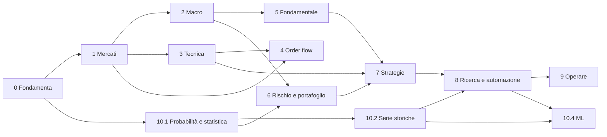
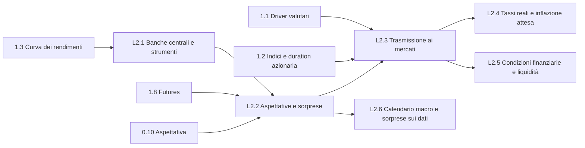

# Dipendenze tra concetti e catene di trasmissione

Versione 1.0 · 11/11/2026

Due tipi di collegamento:
- **Prerequisito** (→): per capire B serve A. Determina l'ordine didattico.
- **Causale** (⇒): A influenza B nel mondo. Ogni anello causale porta un livello di evidenza (E1–E7, vedi `governance/STANDARD.md`).

## 1. Catene causali esemplari

### 1.1 Decisione della Federal Reserve → rischio dell'operazione
Sviluppata nella lezione [L2.3](../moduli/m02-macro/L2.3-trasmissione-ai-mercati.md).

| # | Anello | Meccanismo | Evidenza | Fonte chiave |
|---|---|---|---|---|
| 1 | Annuncio ⇒ aspettative sui tassi | Conta solo la parte **inattesa**; la parte attesa è già nei futures | E1 | Kuttner (2001) |
| 2 | Aspettative ⇒ rendimenti obbligazionari | Ipotesi delle aspettative + premio a termine; le parole (path) muovono la parte lunga più delle azioni (target) | E1/E2 | Gürkaynak, Sack, Swanson (2005) |
| 3 | Rendimenti ⇒ dollaro | Differenziale di tasso atteso; la parità scoperta (UIP) fallisce nel breve | E2 | Fama (1984) sul forward premium puzzle |
| 4 | Tassi e dollaro ⇒ condizioni di liquidità | Costo del funding in dollari, leva degli intermediari, credito | E2/E3 | Adrian e Shin (2010); Rey (2013) |
| 5 | Tassi ⇒ valutazioni azionarie | Tasso di sconto e soprattutto **premio per il rischio**: una sorpresa di −25 bp ≈ +1% sugli indici | E2 | Bernanke e Kuttner (2005) |
| 6 | Valutazioni e incertezza ⇒ volatilità | Volatilità implicita reagisce alle sorprese; esiste un canale "risk-taking" | E2/E3 | Bekaert, Hoerova, Lo Duca (2013) (**C**) |
| 7 | Volatilità ⇒ posizionamento | Fondi con target di volatilità, risk parity, CTA riducono l'esposizione quando la volatilità sale | E3/E4 | Letteratura su vol-targeting; meccanismo plausibile, ampiezza discussa |
| 8 | Posizionamento ⇒ order flow | Ribilanciamenti, coperture, chiusure forzate generano flusso direzionale | E3 | Brunnermeier, Pedersen (2009) per le spirali di liquidità |
| 9 | Order flow ⇒ struttura del prezzo | Il prezzo si muove con il flusso netto (impatto); la liquidità si ritira nello stress | E1 (impatto) / E2 | Kyle (1985); letteratura sull'impatto |
| 10 | Struttura ⇒ rischio dell'operazione | Volatilità più alta → stop più larghi → size minore a parità di R; gap e slippage | E1 (aritmetica) | Modulo 0, lezioni 11–13 |

Lettura critica: gli anelli 1, 2, 5 e 9 sono misurati con buona identificazione; 4, 7, 8 sono plausibili ma l'ampiezza è incerta e dipende dal regime. **La catena non è una previsione**: ogni anello può essere interrotto o invertito (vedi "effetto informativo", lezione L2.2).

### 1.2 Volatilità → psicologia dell'operatore

| # | Anello | Meccanismo | Evidenza |
|---|---|---|---|
| 1 | Volatilità ⇒ distribuzione dei rendimenti | Clustering di volatilità, code più grasse nei regimi agitati | E1 (Engle 1982; Bollerslev 1986) |
| 2 | Distribuzione ⇒ dimensionamento | Size = rischio in € / distanza dello stop; stop proporzionale alla volatilità | E1 (aritmetica) |
| 3 | Dimensionamento ⇒ rischio di rovina | A parità di size, volatilità maggiore → strisce e drawdown più profondi | E1 (Modulo 0.13) |
| 4 | Volatilità ⇒ margini | Le CCP alzano i margini quando sale la volatilità (prociclicità) | E2 |
| 5 | Margini ⇒ liquidità | Margin call → vendite forzate → meno liquidità | E2 (Brunnermeier-Pedersen 2009) |
| 6 | Liquidità ⇒ slippage | Spread e impatto più ampi | E1 |
| 7 | Slippage ⇒ drawdown | Costi realizzati superiori a quelli del backtest | E1 |
| 8 | Drawdown ⇒ rischio di portafoglio | Correlazioni verso +1 nelle crisi | E2 |
| 9 | Drawdown ⇒ psicologia | Loss aversion, stress, rottura delle regole | E2/E3 (Modulo 0.19–0.21) |

## 2. Grafo dei prerequisiti (macro-livello)

## 3. Grafo dei prerequisiti del Modulo 2 (dettaglio)

## 4. Concetti raggiungibili da più percorsi (indice incrociato)

| Concetto | Percorsi d'accesso |
|---|---|
| Aspettativa | 0.10 (trade) · L2.2 (prezzi incorporano aspettative) · 5 (valutazione) · 7 (edge) |
| Volatilità | 0.13 (drawdown) · 1.5 (come asset) · 10.2 (GARCH) · 6 (sizing) · 10.5 (opzioni) |
| Liquidità | 1.18 (microstruttura) · L2.5 (liquidità globale) · U (funding) · 6 (rischio di liquidità) |
| Duration | 1.2 (azioni growth) · 1.3 (bond) · L2.3 (trasmissione) · X |
| Sorpresa | L2.2 (politica monetaria) · L2.6 (dati macro) · 5 (earnings) · T (event study) |
| Correlazione | 1.6 · 6 (portafoglio) · 10.1 (stima) · Y (rottura nelle crisi) |
