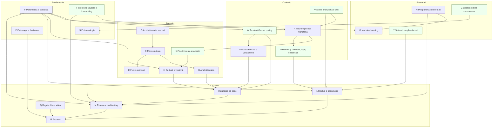

# Mappa generale delle competenze

**Versione 2.0 · 23/11/2026** (Claude, su richiesta del titolare).
- **Parte A (nuova):** dove va il progetto, quali capacità servono per arrivarci, che cosa c'è e che cosa manca.
- **Parte B (invariata dall'11/11, versione 1.0):** la mappa delle materie (A–Z) del percorso di studio.

Fonti della parte A: `piano/PROGETTO-GENERALE-20261123.md`, `governance/DECISIONI.md` (D-01…D-55), l'audit globale del 19/11, la revisione critica del 23/11.

---

# Parte A · Dove andiamo e che cosa ci manca (23/11/2026)

**La destinazione (D-14, D-30, D-42, D-46).** Un conto FTMO operato con poche strategie certificate:
- ognuna con un vantaggio di almeno **+0,25 R a trade**;
- passate dalla riserva storica, dalla prova in avanti e dalla demo;
- seguite dentro una **fabbrica di ricerca multi-mercato** che prova molte idee e ne tiene pochissime;
- obiettivo di rendimento: l'1–2% al mese.

**Il tragitto ha quattro tratti:**
1. la macchina che giudica;
2. le idee da giudicare;
3. la prova nel tempo e in demo;
4. l'esecuzione protetta.

Oggi il tratto 1 è quasi finito; gli altri sono appena iniziati o fermi.

## A.1 Capacità per tratto

Legenda: ✅ c'è e funziona · 🔄 in corso · 🟡 costruito, mai usato davvero · ⏳ manca · ⛔ fermo per decisione.

### Tratto 1 · La macchina che giudica una strategia

| Capacità | Stato | Che cosa manca | Materie (parte B) |
|---|---|---|---|
| Dati storici puliti, con controllo e custodia | ✅ XAUUSD BID e ASK 2005–2026, consuntivo, copia su due cloud | Seconda fonte (confronto con MT5); diagnosi del manifesto sui registri veri | N, C |
| Partizione cieca e regole di spesa della riserva | ✅ D-29, D-38, registro `riserva/2` | Date esatte, embargo, quarantena; registro vero da creare | M, F |
| Ipotesi sigillata prima dei dati (scheda H-003) | 🔄 modello approvato in parte (D-32), contratto leggibile dalla macchina | **Procedura di potenza ricalcolabile** dentro il contratto (DGS-17 Q9) | M, S |
| Simulatore della strategia minuto per minuto | ✅ solo per la rottura del range di Londra (`orb_londra.py`) | **Motore generico** a regole e parametri; sessioni e costi per mercato | N, D, C |
| Screening sullo sviluppo | ✅ D-36, D-47, byte verificati | — | M, F |
| Verdetto statistico onesto | ✅ D-31 collaudato su dati sintetici, decisioni esatte, tipi nei rapporti | Ambiente di riferimento unico (D-54) | F, M, S |
| Conteggio di tutte le prove (N) | ✅ registro unico | Registro unico **su tutti i mercati** (DA-28) | M |
| Difesa contro errori e manomissioni | 🔄 140 difetti corretti; revisione R19 in corso | Lettura solo dopo l'autorizzazione pubblicata (D-55); protezione del ramo (DA-39) | N, R |

### Tratto 2 · Le idee da giudicare

| Capacità | Stato | Che cosa manca | Materie (parte B) |
|---|---|---|---|
| Generare idee **forti** (≥ +0,25 R, regolari) | ⏳ nessuna candidata. H-001 chiusa, H-002 parcheggiata, P-001 in pausa (D-33) | Un flusso di idee del titolare e della letteratura, scritte come regole meccaniche | I, D, C, W, T |
| Sapere da dove viene un'idea e se è contaminata | ✅ registro della provenienza (D-32) | — | S, Z |
| Ragione economica di un vantaggio | 🟡 il modello H-003 la chiede già (§1, «meccanismo»), mai compilata per un'ipotesi vera | Saperla scrivere e criticare: è il filtro che separa un'idea da un caso | W, B, C |
| Dati di contorno: notizie, orari, festività | ⏳ | Calendario storico delle notizie (P-08); orari per mercato | A, B |
| Più mercati e famiglie indipendenti | ⏳ pianificati (DA-27, DA-28, D-46) | Scaricatore e calendario per altri strumenti; famiglie di mercati dichiarate | B, L, Y |

### Tratto 3 · La prova nel tempo e in demo

| Capacità | Stato | Che cosa manca | Materie (parte B) |
|---|---|---|---|
| Prova in avanti simulata, ogni giorno, su molte strategie | ⏳ decisa come direzione (D-46) | Motore generico; dove gira (DA-33); conteggio in N | N, M |
| Demo con costi veri | 🟡 demo FP Markets creata | Misura di spread e commissione per ora; broker del conto da 50.000 USD (DA-25) | C, B |
| Quando fermarsi | 🟡 test di Wald simulato (DA-29) | Soglie decise prima, applicate a una strategia vera | F, L |
| Portafoglio di strategie | ⏳ | Correlazioni misurate, rischio totale entro l'1,5% al giorno | L, Y, F |

### Tratto 4 · L'esecuzione protetta

| Capacità | Stato | Che cosa manca | Materie (parte B) |
|---|---|---|---|
| Guardian G0 (limiti FTMO, regole personali) | 🟡 77 test, mai riconciliato | Riconciliazione con un estratto conto (DA-25); P-15 | L, Q, R |
| Journal e previsioni (Brier) | 🟡 costruito, zero dati veri | Uso quotidiano in demo | P, Z |
| Alert sul telefono, poi ordine precompilato (D-45) | ⏳ | Ore del titolare (DA-32); collegamento con MetaTrader | N, R |
| Disciplina del titolare | 🟡 14 regole personali confermate | Indicatori comportamentali accesi (DA-12) | P |
| Regole FTMO aggiornate | 🟡 lette il 12/11 | Rilettura prima della sfida (overnight, notizie, Expert Advisor) | Q |

## A.2 Le cinque mancanze che pesano di più

1. **Idee forti.** La macchina boccia con onestà, ma promuove solo vantaggi forti e regolari (§6 del progetto generale). Senza un flusso di idee buone, la fabbrica gira a vuoto. È la mancanza più grande, e non è di codice.
2. **Motore generico.** Oggi ogni idea nuova richiede un simulatore nuovo e giri di revisione. Il costo di un'ipotesi va portato da settimane a giorni.
3. **Potenza calcolata dalla macchina** e lettura della riserva solo dopo l'autorizzazione pubblicata (D-55): bloccanti prima del primo accesso reale.
4. **Prova in avanti quotidiana:** è il vero banco di prova illimitato (D-46), e oggi non esiste.
5. **Pilastro della protezione mai usato:** Guardian e journal vanno riconciliati e usati in demo prima che servano davvero.

## A.3 Competenze del titolare (pilastro conoscenza)

- Il percorso di studio (parte B) è **fermo** dal 12/11 (D-10, D-12, D-20): Modulo 2 in verifica, nessun registro dei cancelli superati.
- Le materie che servono **prima** per il tratto 2 sono:
  - **I** (strategie e ragione economica);
  - **D e C** (tradurre l'analisi tecnica e la microstruttura in regole misurabili);
  - **W** (perché un vantaggio dovrebbe esistere);
  - **F** quanto basta per leggere un verdetto.
- Riattivare la formazione è una decisione del titolare: era fra le quattro dell'audit del 19/11, mai presa.

---

# Parte B · Mappa delle materie (versione 1.0 · 11/11/2026, invariata)

La mappa ha tre livelli:
1. **Nucleo** — le aree che descrivono il funzionamento dei mercati (A–I).
2. **Controllo** — le aree che decidono se una conoscenza diventa un'azione sensata (L, M, Q, R).
3. **Strumenti e fondamenta** — le aree che servono a tutte le altre (F, N, O, P, S) e le nuove aree trasversali (T–Z).

In verde le aree nuove, non presenti nella richiesta iniziale.

## Aree richieste (A–S)

Per ciascuna: **perché conta** e **dove va nell'architettura** (vedi `architettura/ARCHITETTURA.md`).

| Area | Perché conta per un Brain che vuole capire i mercati | Modulo |
|---|---|---|
| A Economia e macro | Fissa il prezzo del denaro e il regime in cui tutto il resto opera. Senza A, ogni movimento sembra casuale o "tecnico". | 2 |
| B Architettura | Chi c'è dall'altra parte, con quali vincoli: è la risposta alla domanda "chi perde e perché" sull'edge. | 1, 9 |
| C Microstruttura | Come l'informazione diventa prezzo; determina i costi reali di ogni strategia. | 1.5 → 4 |
| D Analisi tecnica | Linguaggio diffuso tra operatori; va tradotto in regole misurabili e testato. | 3 |
| E Flussi avanzati | Lettura fine dell'asta; area ad alto rischio di gergo non verificato. | 4 |
| F Matematica e statistica | Lingua di tutte le verifiche: senza F, M e L sono atti di fede. | traccia Q (10.1–10.3) |
| G Fondamentale | Ancora il prezzo a flussi di cassa e aspettative; base di value, quality, event-driven. | 5 |
| H Derivati e volatilità | Il rischio ha un prezzo quotato; le opzioni dicono cosa il mercato teme. | 1.2 → 10.5 |
| I Strategie | Il repertorio: ogni famiglia con la sua ragione economica e il suo modo di fallire. | 7 |
| L Rischio e portafoglio | Ciò che decide la sopravvivenza; l'unica variabile pienamente controllabile. | 6 |
| M Ricerca e backtesting | Il filtro che separa un'ipotesi da un'illusione. | 8 |
| N Programmazione | Rende riproducibile ogni affermazione quantitativa. | 8 (traccia N) |
| O Machine learning | Utile per alcuni problemi, pericoloso per l'overfitting; va dopo F e M. | 10.4 |
| P Psicologia | L'esecutore è parte del sistema; i bias si misurano anche nei mercati (bolle, gregge). | 0, 10.8 |
| Q Regole, fisco, etica | Vincoli legali reali e confini etici (market abuse). | 9 |
| R Processi | Trasforma la conoscenza in comportamento ripetibile e verificabile. | 6, 9 |
| S Epistemologia | Attraversa tutto: cosa sappiamo, come lo sappiamo, quanto ne siamo sicuri. | 0 + ogni lezione |

## Aree nuove proposte (T–Z) e sottodiscipline mancanti

Identificate confrontando la mappa con: curriculum CFA (livelli I–III), FRM (GARP), programmi di laurea magistrale in finanza quantitativa ed economia monetaria, corsi aperti (MIT OCW 18.S096, 15.401; Open Yale ECON 252), i manuali di riferimento in bibliografia. Il confronto è stato fatto sulla struttura nota di questi programmi (**C**: non riletti in questa sessione).

| Area nuova | Contenuti | Perché è importante | Completa |
|---|---|---|---|
| **T · Inferenza causale e forecasting** | Event study (MacKinlay 1997), identificazione ad alta frequenza, diff-in-diff, variabili strumentali, controlli sintetici; previsione probabilistica, calibrazione, Brier score, scoring rules, superforecasting (Tetlock) | Il Brain deve rispondere a "perché il mercato sale?" senza confondere correlazione e causa, e deve misurare la qualità delle proprie previsioni | A, M, S |
| **U · Plumbing finanziario** | Riserve bancarie, mercati monetari, repo, collaterale, eurodollaro, shadow banking, swap lines, funding liquidity vs market liquidity (Brunnermeier-Pedersen 2009) | Le crisi del 2008, marzo 2020, settembre 2019 (repo), UK LDI 2022 si capiscono solo da qui; è il ponte tra banca centrale e prezzi | A, B, L |
| **V · Storia finanziaria e delle crisi** | Bolle e crisi (Kindleberger; Reinhart-Rogoff), 1929, 1987, LTCM 1998, dot-com, 2008, 2020, 2022; storia dei regimi monetari | Fornisce base rate di eventi rari, che i dati di 10 anni non contengono | L, P, A |
| **W · Teoria dell'asset pricing** | Valore atteso scontato, fattore di sconto stocastico, CAPM e APT, modelli fattoriali, premio per il rischio, efficienza (Fama 1970) e mercati adattivi (Lo 2004), limiti all'arbitraggio (Shleifer-Vishny 1997) | Dà la "ragione economica" che il Modulo 0 chiede a ogni edge | G, I, L |
| **X · Fixed income avanzato** | Pricing, duration/convessità, curve zero e forward, modelli di struttura a termine, swap, credito, spread, inflation-linked e breakeven | I tassi sono il prezzo base di tutti gli altri asset; nel v1 c'è una riga | A, H, L |
| **Y · Sistemi complessi e reti** | Contagio, leva e prociclicità, feedback loop, cascate di liquidazione, leggi di potenza, agent-based models, econofisica (Bouchaud) | Spiega code grasse e crolli come proprietà del sistema, non come sfortuna | L, C, P |
| **Z · Gestione della conoscenza** | Registro delle fonti, versioni, revisione periodica, spaced repetition del Brain stesso, revisione tra pari | È il meccanismo con cui il Brain cresce per anni senza degradarsi | tutto |

Altre sottodiscipline da integrare nelle aree esistenti:

| Sottodisciplina | Dove | Motivo |
|---|---|---|
| Contabilità nazionale e statistica economica (come si costruiscono PIL, CPI, payroll; revisioni; dati "real-time" e vintages) | A | Un dato macro è una stima rivista; testare su dati rivisti produce look-ahead bias |
| Comunicazione delle banche centrali (statement, minute, dot plot, conferenze) e NLP sui testi | A, O | Il canale "parole" pesa quanto i tassi (Gürkaynak-Sack-Swanson 2005) |
| Economia dell'informazione e teoria dei giochi | C, W | Kyle, Glosten-Milgrom e Grossman-Stiglitz sono modelli di giochi con informazione asimmetrica |
| Rischio climatico e scenari NGFS | L, A | Entra negli stress test di vigilanza |
| Narrative economics (Shiller 2019) e sociologia della finanza | P, V | Come le storie si diffondono e muovono i prezzi |
| Household finance e finanza personale | 0.23 | Già presente; da collegare alla letteratura (Campbell 2006) |
| Ottimizzazione numerica | F | Necessaria per portafoglio e stime di massima verosimiglianza |
| Ingegneria del software per la ricerca (test, riproducibilità, point-in-time data) | N | Senza, i backtest non sono verificabili |
