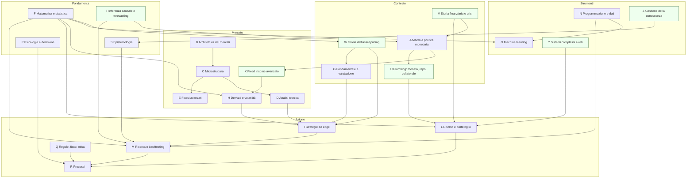

# Mappa generale delle competenze

Versione 1.0 · 11/11/2026

La mappa ha tre livelli:
1. **Nucleo** — le aree che descrivono il funzionamento dei mercati (A–I).
2. **Controllo** — le aree che decidono se una conoscenza diventa un'azione sensata (L, M, Q, R).
3. **Strumenti e fondamenta** — le aree che servono a tutte le altre (F, N, O, P, S) e le nuove aree trasversali (T–Z).

In verde le aree nuove, non presenti nella richiesta iniziale.

## Aree richieste (A–S)

Per ciascuna: **perché conta** e **dove va nell'architettura** (vedi `architettura/ARCHITETTURA.md`).

| Area | Perché conta per un Brain che vuole capire i mercati | Modulo |
|---|---|---|
| A Economia e macro | Fissa il prezzo del denaro e il regime in cui tutto il resto opera. Senza A, ogni movimento sembra casuale o "tecnico". | 2 |
| B Architettura | Chi c'è dall'altra parte, con quali vincoli: è la risposta alla domanda "chi perde e perché" sull'edge. | 1, 9 |
| C Microstruttura | Come l'informazione diventa prezzo; determina i costi reali di ogni strategia. | 1.5 → 4 |
| D Analisi tecnica | Linguaggio diffuso tra operatori; va tradotto in regole misurabili e testato. | 3 |
| E Flussi avanzati | Lettura fine dell'asta; area ad alto rischio di gergo non verificato. | 4 |
| F Matematica e statistica | Lingua di tutte le verifiche: senza F, M e L sono atti di fede. | traccia Q (10.1–10.3) |
| G Fondamentale | Ancora il prezzo a flussi di cassa e aspettative; base di value, quality, event-driven. | 5 |
| H Derivati e volatilità | Il rischio ha un prezzo quotato; le opzioni dicono cosa il mercato teme. | 1.2 → 10.5 |
| I Strategie | Il repertorio: ogni famiglia con la sua ragione economica e il suo modo di fallire. | 7 |
| L Rischio e portafoglio | Ciò che decide la sopravvivenza; l'unica variabile pienamente controllabile. | 6 |
| M Ricerca e backtesting | Il filtro che separa un'ipotesi da un'illusione. | 8 |
| N Programmazione | Rende riproducibile ogni affermazione quantitativa. | 8 (traccia N) |
| O Machine learning | Utile per alcuni problemi, pericoloso per l'overfitting; va dopo F e M. | 10.4 |
| P Psicologia | L'esecutore è parte del sistema; i bias si misurano anche nei mercati (bolle, gregge). | 0, 10.8 |
| Q Regole, fisco, etica | Vincoli legali reali e confini etici (market abuse). | 9 |
| R Processi | Trasforma la conoscenza in comportamento ripetibile e verificabile. | 6, 9 |
| S Epistemologia | Attraversa tutto: cosa sappiamo, come lo sappiamo, quanto ne siamo sicuri. | 0 + ogni lezione |

## Aree nuove proposte (T–Z) e sottodiscipline mancanti

Identificate confrontando la mappa con: curriculum CFA (livelli I–III), FRM (GARP), programmi di laurea magistrale in finanza quantitativa ed economia monetaria, corsi aperti (MIT OCW 18.S096, 15.401; Open Yale ECON 252), i manuali di riferimento in bibliografia. Il confronto è stato fatto sulla struttura nota di questi programmi (**C**: non riletti in questa sessione).

| Area nuova | Contenuti | Perché è importante | Completa |
|---|---|---|---|
| **T · Inferenza causale e forecasting** | Event study (MacKinlay 1997), identificazione ad alta frequenza, diff-in-diff, variabili strumentali, controlli sintetici; previsione probabilistica, calibrazione, Brier score, scoring rules, superforecasting (Tetlock) | Il Brain deve rispondere a "perché il mercato sale?" senza confondere correlazione e causa, e deve misurare la qualità delle proprie previsioni | A, M, S |
| **U · Plumbing finanziario** | Riserve bancarie, mercati monetari, repo, collaterale, eurodollaro, shadow banking, swap lines, funding liquidity vs market liquidity (Brunnermeier-Pedersen 2009) | Le crisi del 2008, marzo 2020, settembre 2019 (repo), UK LDI 2022 si capiscono solo da qui; è il ponte tra banca centrale e prezzi | A, B, L |
| **V · Storia finanziaria e delle crisi** | Bolle e crisi (Kindleberger; Reinhart-Rogoff), 1929, 1987, LTCM 1998, dot-com, 2008, 2020, 2022; storia dei regimi monetari | Fornisce base rate di eventi rari, che i dati di 10 anni non contengono | L, P, A |
| **W · Teoria dell'asset pricing** | Valore atteso scontato, fattore di sconto stocastico, CAPM e APT, modelli fattoriali, premio per il rischio, efficienza (Fama 1970) e mercati adattivi (Lo 2004), limiti all'arbitraggio (Shleifer-Vishny 1997) | Dà la "ragione economica" che il Modulo 0 chiede a ogni edge | G, I, L |
| **X · Fixed income avanzato** | Pricing, duration/convessità, curve zero e forward, modelli di struttura a termine, swap, credito, spread, inflation-linked e breakeven | I tassi sono il prezzo base di tutti gli altri asset; nel v1 c'è una riga | A, H, L |
| **Y · Sistemi complessi e reti** | Contagio, leva e prociclicità, feedback loop, cascate di liquidazione, leggi di potenza, agent-based models, econofisica (Bouchaud) | Spiega code grasse e crolli come proprietà del sistema, non come sfortuna | L, C, P |
| **Z · Gestione della conoscenza** | Registro delle fonti, versioni, revisione periodica, spaced repetition del Brain stesso, revisione tra pari | È il meccanismo con cui il Brain cresce per anni senza degradarsi | tutto |

Altre sottodiscipline da integrare nelle aree esistenti:

| Sottodisciplina | Dove | Motivo |
|---|---|---|
| Contabilità nazionale e statistica economica (come si costruiscono PIL, CPI, payroll; revisioni; dati "real-time" e vintages) | A | Un dato macro è una stima rivista; testare su dati rivisti produce look-ahead bias |
| Comunicazione delle banche centrali (statement, minute, dot plot, conferenze) e NLP sui testi | A, O | Il canale "parole" pesa quanto i tassi (Gürkaynak-Sack-Swanson 2005) |
| Economia dell'informazione e teoria dei giochi | C, W | Kyle, Glosten-Milgrom e Grossman-Stiglitz sono modelli di giochi con informazione asimmetrica |
| Rischio climatico e scenari NGFS | L, A | Entra negli stress test di vigilanza |
| Narrative economics (Shiller 2019) e sociologia della finanza | P, V | Come le storie si diffondono e muovono i prezzi |
| Household finance e finanza personale | 0.23 | Già presente; da collegare alla letteratura (Campbell 2006) |
| Ottimizzazione numerica | F | Necessaria per portafoglio e stime di massima verosimiglianza |
| Ingegneria del software per la ricerca (test, riproducibilità, point-in-time data) | N | Senza, i backtest non sono verificabili |
